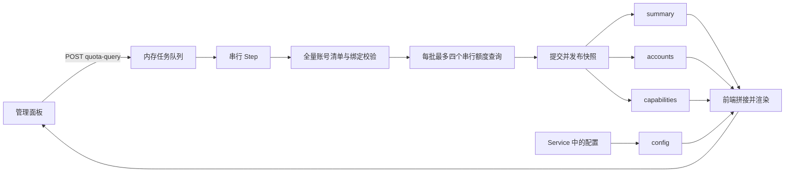

# 前后端数据传输与同步分析

分析日期：2026-10-14。范围为当前本地源码，包含本次会话前一轮增加的手动额度查询进度轮询。初次分析只复现和记录；后续实现状态见下一节。未发布插件或连接生产 CPA。

## 修复实施状态

本报告下文保留修复前的分析记录。后续完善已实现版本化统一 `/snapshot`、同会话响应顺序与写操作保护、三类任务的 `job_id` 与最近 64 个结果保留、任务接受及逐账号进度发布、全局依赖故障的阻塞原因与 2 分钟等待上限、单账号清单错误隔离，以及重启/淘汰/未知送达的明确展示。账号证据与成功结果在同一提交发布边界可见，失败提交不发布成功。管理 API、运行时、适配器和浏览器已补充对应回归测试；未连接实际部署。上述修复随 v0.1.0-rc.15 发布；版本说明见 [rc.15](releases/v0.1.0-rc.15.md)。

## 结论

当前存在可复现的数据一致性问题。HTTP 请求成功与否不足以解释页面状态：服务端缺少覆盖整个视图的快照版本，前端缺少同一会话内的响应顺序保护，异步操作缺少统一的任务身份和结果查询方式。后台清单同步失败还可以使任务实际无法执行，而页面只显示排队。

上一轮修复补上了手动额度查询期间的持续读取，解决了默认关闭自动刷新后不再读取结果的问题；它没有解决下列并发、跨接口和任务状态问题。

## 当前数据链路



`202 queued` 只表示内存队列接受了请求，既不表示已发出额度请求，也不保证下一次 GET 已经能看到该任务。

## 1. 高优先级：旧响应能覆盖更新的结果和设置

位置：`internal/plugin/web/panel.js:701`、`:737`、`:759`、`:846`、`:900`。

- `readSnapshots()` 和 `readRunningConfig()` 只校验会话 generation。它能防止断开、重新连接后的旧响应进入新会话，不能区分同一会话中的新旧读取。
- `pollBusy` 只约束 `refreshSnapshots()`。查询、保存、重新加载等操作直接调用 `readSnapshots()` / `readRunningConfig()`，可以与已经进行中的轮询重叠。
- 响应完成后直接赋值，没有请求序号或服务端快照版本比较。

已复现两种情况：

1. 轮询 A 先发出并读取旧数据，账号响应被延迟；随后手动查询 B 完成，页面显示 `73% / 成功 1`；最后 A 返回，页面退回 `80% / 成功 0`。
2. 保存后服务端 `quota_query.automatic=true`，编辑框也已显示开启；保存前发出的旧 `/config` 返回后，总览重新显示“定期查询：关闭”。

这证明页面显示回退不等于后台额度回退或配置保存失败。仅提高轮询频率不能消除该竞态。

## 2. 高优先级：账号清单失败可让手动查询真正一直排队

位置：`internal/cpa/host.go:82`、`internal/runtime/manual_quota.go:52`、`internal/runtime/engine.go:367`。

每个新手动任务都会强制重新读取全量账号清单。`Host.Accounts()` 遍历所有 Codex 账号，只要一个账号的身份或凭据绑定无法读取，就返回整个清单失败。例如缺少必要元数据、runtime-only 账号、账号绑定读取错误均可触发；访问 token 过期本身不应与这些清单错误混为一谈。

`Step()` 在执行手动查询之前处理该错误并返回，随后按 30 秒清单退避继续尝试。任务没有整体等待期限，也不进入失败终态：

- `quota_query.phase` 仍为 `queued`；
- `quota_query.failed` 仍为 0；
- 任务自身 `last_error` 为空；
- 顶层 `summary.last_error` 为 `account_read_failed`；
- 查询能力可以仍显示 `QuotaAdapterReady=true`；
- 其他手动目标会得到 `busy`。

已分别复现“一个健康账号加一个不支持的 runtime-only 账号，清单整体失败”和“连续三次清单重试，健康目标一次额度请求都没发出，手动任务仍排队”。两个现象通过上述调用链相连。

这属于后台执行阻塞。前端即使持续正确轮询，也不会得到完成结果。清单必须保留身份校验，修复时需要隔离单账号错误并显式发布阻塞原因，不能简单忽略身份错误继续发送模型请求。

## 3. 高优先级：缺少任务 ID，多页面操作会丢失结果归属

位置：`internal/plugin/service.go:578` 前的额度查询响应、`internal/runtime/manual_quota.go:9`、`internal/plugin/web/panel.js:376`。

额度查询返回 `status/account_id`，快照只保留最近一次手动查询。前端用目标账号和 `started_at` 判断是否看到了本次任务，没有服务端任务 ID，也没有按任务 ID 获取结果的接口。

已模拟两个页面依次操作：页面 A 提交账号 A；其任务完成后，页面 B 的账号 B 查询也完成，替换了“最近查询”；页面 A 下一次读取时只能看到 B 的完成结果。由于目标不匹配，A 的本地 `pendingQuotaQuery` 连续五轮仍不清除，始终显示 A“已排队，等待查询”。后端此时可以已经空闲。

任务串行执行并不能避免这一问题：两次任务可以先后完成于同一个 5 秒读取间隔内。仅增加本地超时也不能恢复已经失去归属的结果。

内容生成已有 `request_id`，可作为统一任务协议的起点；额度查询和手动唤醒尚未统一。

## 4. 中优先级：接口之间及单个 summary 内部都没有一致性边界

位置：`internal/plugin/service.go:486`、`:493`、`:516`、`:522`，`internal/runtime/status.go:13`。

后台已经使用不可变的 `publishedStatus` 和原子指针发布，这是正确的基础。但对外读取没有保留同一次原子加载的边界：

- `/summary` 先 `Snapshot()`，再 `Diagnostics()`，再 `SchedulerDiagnostics()`；这些调用各自加载一次指针，期间可以有新快照发布。
- `/accounts` 和 `/capabilities` 是独立请求，`/config` 来自 Service 的另一份配置。
- 账号和能力响应没有可与 summary 对齐的快照版本；前端也没有版本校验。
- 现有 `summary.revision` 是持久化 CoreState 的 revision，不覆盖所有运行时进度、诊断和配置变化，不能直接当成整个页面的版本。

因此可能同屏出现“任务完成、额度旧值”“新调度计划、旧配置”或不同版本的数量、能力状态。本项由读取路径确认；本轮未通过生产请求测量实际发生频率。

## 5. 中优先级：后台正在执行时，公开进度仍可能是旧状态

位置：`internal/runtime/engine.go:346`、`internal/runtime/manual_quota.go:73`、`internal/runtime/status.go:35`。

手动任务的 queued/running 状态先更新在 Engine 内部；对外通常要等当前 Step 提交或退出后才发布。批内最多四个额度请求串行执行，中间没有发布每个账号的进度。

已用受控宿主阻塞额度网络调用：请求确实正在执行，但公开任务 phase 仍为空；释放网络调用后直接变成 completed。已有旧任务时，读到的也可能是上一次的终态。

按配置计算，四个请求依次用满默认 15 秒超时，单批可能约 60 秒不更新；配置为每账号 5 分钟时，单批可能约 20 分钟。账号清单同步和其他串行调度操作还可能增加等待。这些时间是假设各请求正确响应超时的估计，不是宿主 C 回调绝对返回时间的保证。

不能通过把未提交账号状态提前公开来修复。应将可变任务进度与已持久化的账号证据分开处理，再提供一致的对外快照。

## 6. 中优先级：读取失败与任务失败没有清楚区分

位置：`internal/plugin/web/panel.js:701`、`:737`。

`readSnapshots()` 使用 `Promise.all`，只有 summary、accounts、capabilities 全部成功才替换视图。任何一个辅助接口失败，已经成功取得的任务状态也不会显示。

已复现 `/summary` 返回 completed，而 `/capabilities` 失败，页面继续显示旧的 queued。页面有网络错误提示，但任务行仍表示等待，用户难以判断后台是否执行。

“读取于”是浏览器成功接收这一轮数据的时间，不能证明账号额度或任务快照是新数据。应分别呈现任务状态、视图更新时间、账号证据时间和数据过期情况。多接口直接部分应用也会产生混版，宜先解决快照协议。

## 7. 体验与协议缺口：异步操作的跟踪方式不统一

位置：`internal/plugin/web/panel.js:510`、`:710`、`:874`。

上一轮增加的自动跟踪只覆盖额度查询。手动唤醒和内容生成仍在 POST 后立即读取一次；页面自动刷新关闭时，需要用户手动刷新才能看到后续结果。

已复现手动唤醒接受后显示排队，但没有安排任何下一轮读取。内容生成的相同限制由调用路径确认。现有文档已说明这两类操作需要手动刷新，因此应视为明确的体验和协议不一致，而不是声称它们违反了已承诺的自动跟踪行为。

## 建议修复顺序

1. **先消除真正的无限等待**：给任务发布 `blocked_reason/retry_at/updated_at` 和有界的等待策略；账号清单区分全局错误与单账号错误，健康账号的只读查询不应被无关坏账号永久阻塞。
2. **统一任务身份与结果**：每次操作返回服务端 `job_id`，相同操作合并时返回同一个 ID；保留可按 ID 查询的结果，明确 queued、running、blocked、completed、failed、cancelled、unknown 的转换。模型发送结果不确定时继续保持不自动重试。
3. **提供统一状态快照**：一个管理 GET 从同一份已发布数据返回 summary、accounts、capabilities 和生效配置标识。增加 `instance_id + snapshot_seq`；持久化状态 revision、任务版本和配置文件 revision 分别表达自己的含义。
4. **集中前端状态更新**：所有读取经过同一入口；写操作确认后作废旧读取，拒绝较旧的快照，避免直接分散赋值。前端读取序号解决同会话乱序，服务端版本解决跨请求及重启后的版本判断。
5. **统一异步操作跟踪和错误展示**：跟踪指定 job_id 到终态，断网恢复后继续对账；页面读取失败保留已知任务结果并标明陈旧，不把读失败当成任务失败。按账号或合理时间间隔发布进度。

HTTP 轮询本身可以满足当前需求。仅换成 WebSocket/SSE，或把间隔从 5 秒缩短，都不能自动解决任务归属、旧响应覆盖及清单阻塞。

## 本轮验证与边界

新增的临时审计复现位于 `/tmp/cpa-sync-audit`，不覆盖现有源码或正式测试：

```sh
/usr/bin/node /tmp/cpa-sync-audit/frontend.test.cjs
GOCACHE=/tmp/codex-window-refresh-go-cache go test \
  -overlay /tmp/cpa-sync-audit/overlay.json \
  ./internal/runtime ./internal/cpa -run '^TestAudit' -v
```

五个前端场景、三个 Go 场景均成功复现上述不良行为；这些审计断言通过意味着问题被重现，不意味着产品行为正确。Go 使用 overlay 加载临时测试文件，没有修改原有包文件。

未连接用户实际服务、读取真实账号凭据或请求上游。因此可以确认源码中存在这些缺陷，但不能断言某一项就是当前部署中的唯一原因。对实际排队问题，应在同一时间对照 `summary.last_error`、`scheduler.quota_query`、`scheduler.observed_at` 和账号证据时间：清单错误持续存在意味着后台阻塞；后台已完成但页面排队或值回退，则优先检查前端对账和响应顺序。
