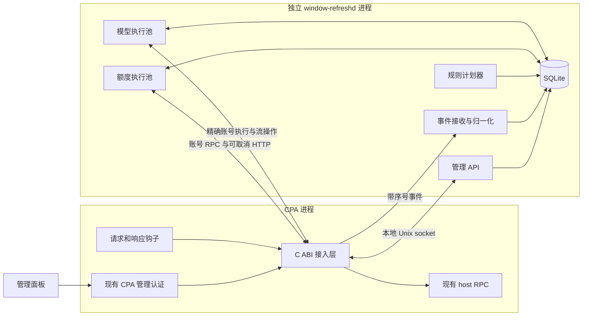

# 后端 v2 重建设计

状态：V2 重建的总体设计记录。当前实现、构建和 API 以 [架构说明](architecture.md)为准，部署行为以 [安装指南](../user/install.md)为准。早期只读原型已扩展为额度查询、候选生成、模型唤醒与账号调度；本页保留目标设计，已被替代的迁移方案在第 12 节说明。

进程连接、配置归属、RPC 生命周期、事务和实机验证要求见 [实施契约](contracts.md)。

## 1. 产品目标与实施边界

模块提供四项能力：账号和额度查看、按规则准备账号窗口、手动查询与唤醒、任务与故障诊断。重建从这些能力出发，采用独立后台服务及持久任务；不继承现有全局串行执行、全量 JSON 状态和插件内 Go 运行时的结构。

继续遵守已经确定的业务语义：

- 查询额度不发送模型请求，不解除 CPA 的禁用状态；自动查询与自动唤醒分别控制，首次默认关闭。
- 周、五小时和每日规则保持独立；周联合重置是需要验证的业务假设，不能覆盖真实的有效短期窗口。
- 普通唤醒按近期身份和每日目标补容量；真实业务可能自行激活更多账号，插件不接管正常路由。
- 同账号多个成熟原因合并；随机执行时间一旦建立便持久化，重启和修改无关配置不重新抽取。
- 上游窗口以证据为准；有效窗口不唤醒；未知额度先查询。
- 模型调用结果不确定时核对证据，不自动重发。容量预约到期和解除重复发送抑制是不同操作。

重建交付面包括后台、原生接入层、管理 API、面板适配、安装与迁移。v1 保持可用，直到 v2 完成验收和单写者交接。

## 2. 部署形态



目标是两个长期组件：

| 组件 | 职责 | 生命周期 |
| --- | --- | --- |
| 原生接入层 | CPA ABI 注册、管理转发、最小观测提取、受限宿主 RPC 桥接 | 随 CPA；协议稳定，低频更新 |
| `window-refreshd` | 规则、任务、并发、额度 HTTP、流消费、数据库、配置及管理视图 | 独立 systemd 服务或容器；可单独升级和重启 |

接入层目标用 C 实现，避免在 CPA 中再装入一个 Go 运行时。具体 JSON/HTTP 库必须在原型中验证内存边界、取消和卸载行为后确定。后台使用 Go；二者以独立协议交互，后台不导入当前 `Engine` 和全量状态存储。

接入层不持有完整历史、规则计划或待执行业务任务，不做 OAuth 刷新，不替 CPA 选账号。钩子不等待后台可用或数据库提交。后台离线时，正常代理请求继续通过，管理操作明确返回服务不可用。

独立后台使规则和历史内存可以随进程退出回收。接入层仍在 CPA 内，不能宣称所有插件故障均与 CPA 隔离。

## 3. 可兼容的宿主能力

现有本地适配契约已使用账号清单、账号运行状态、原始账号读取、精确模型执行、流读取和关闭等 RPC。新接入层逐项沿用经过验证的方法，限定允许调用的方法和字段。

后台首次连接进行版本协商，记录 bridge 实例、CPA 进程身份、协议版本、允许方法、最大在途数与事件连续性。能力声明需要区别三种状态：本地实现支持、目标版本验证通过、本次运行已确认。不能凭 callback 非空就把全部能力标记可用。

下列能力在现有契约中没有得到保证，不能作为新系统正常工作的隐含前提：

| 缺口 | v2 行为 |
| --- | --- |
| 前台和后台精确发送之间的原子互斥 | 发送前核对已知占用与新鲜额度；显示观测级保护，不承诺零竞态 |
| 权威在途请求快照 | 漏回调或连续性丢失时标记 `activity_unknown`，不把 TTL 当成完成证明 |
| 宿主操作持久去重与送达查询 | 后台自行保存发送意图；崩溃、断连或超时后按未知送达恢复 |
| 同步 C 回调的强制终止 | 超时停止等待、触发已有取消/流关闭；真实在途槽保留到 callback 返回 |
| 权威凭据代际 | 使用经核对的账号身份建立本地绑定版本；检测到删除、重建或不匹配时废弃旧证据，不能声称识别所有重新登录 |

若未来宿主增加能力，可扩展协议；v2 的首版实现不要求这些扩展。

## 4. 私有 IPC 与接入层资源边界

同机部署使用 Unix socket，目录归 CPA 服务用户所有且权限 `0700`。校验对端身份；初期后台与 CPA 运行于同一服务用户。容器部署需要显式共享 socket 目录和 UID。后台管理接口不直接公开到网络，浏览器继续使用 CPA 的管理认证入口。

协议分三条独立通路，防止大量事件挤占控制操作：

1. **管理转发**：请求带 request ID、deadline、体积上限，转发到后台；超时按真实状态返回，不伪造任务失败或完成。
2. **宿主调用**：后台提交 operation ID、账号和方法，请求进入接入层有限队列；返回宿主结果或明确的排队/未知状态。重复 operation ID 在同一接入实例内合并，重启后不能依赖此内存去重。
3. **观测事件**：带 bridge instance、递增序号和账号绑定，后台按连续水位确认。事件在后台提交后才推进确认水位。

宿主调用通路禁止自动重放模型发送。接入层的排队、在途和结果缓存都设置条数与字节预算；结果确认后可回收，超过保留范围则返回 `outcome_unavailable`。会话代际与淘汰水位阻止旧 operation ID 被重新当成新发送，不能为实现有界缓存而丢失去重语义。断连后的模型结果由原操作继续核对，后台不会另建一次发送来替代丢失的回执。

接入层为当前 callback 预留固定上限，普通调用和清理调用分别保留资源。RPC 请求即使超过客户端 deadline，已经进入 C 的调用仍占槽，不能靠启动替代线程绕过上限。额度限流不会阻止现有流的关闭操作。

生命周期约束：先停止接收新 RPC，再取消、排空在途调用，最后释放宿主上下文和缓冲。永久不返回的 callback 仍可能阻止安全卸载；接入层报告故障，后台可继续运行查询视图，但不会报告卸载成功。后台升级不需要卸载接入层。

事件缓冲同时限制条数、总字节和单事件大小。响应钩子只提取额度相关的允许字段或受限额度事件，不向后台复制完整 prompt、正文或全部流量。可合并的额度快照与不可静默丢失的生命周期事件分开处理。

缓冲溢出、桥重启、后台断开超过重放范围均产生连续性缺口。后台记录缺口，不把后续“连接成功”当成已恢复全部前台状态。额度查询仍可执行，依赖占用准确性的自动模型派发暂停并给出原因。

## 5. 后台执行结构

采用数据库支持的任务系统。计划器负责创建和更新任务；执行池认领任务；结果处理更新证据和后续任务。不存在跨网络请求持有的全局状态锁，也不让一个全局状态对象负责承载全部历史。

数据库写事务仍按数据库规则串行，但只包含局部读写和条件检查，事务中不进行网络、流读取或休眠。不同账号的网络调用独立并行。

| 工作类型 | 调度方式 | 同账号限制 |
| --- | --- | --- |
| 手动/定期/到期额度查询 | 同一执行池，按类型做公平调度与请求合并 | 同一绑定最多一个实际额度查询 |
| 唤醒前额度核对 | 使用额度池，结果关联待派发操作；等待期间不占模型执行槽 | 能复用满足本轮栅栏要求的在途查询，否则排下一次 |
| 已发送操作验证 | 使用额度池，保留获得服务的机会，按退避安排 | 不因验证超时新增模型请求 |
| 自动/手动唤醒 | 模型执行池；事务完成准入与预约后执行 | 一个账号最多一个未解决模型操作 |
| 短句生成 | 与唤醒共享物理模型预算，采用独立公平队列 | 与该账号唤醒互斥 |
| 清理与计划预览 | 独立本地任务；预览只读 | 不占上游执行槽 |

任务优先级只决定机会，不跳过账号、窗口或容量检查。全账号手动查询建立一个父任务和分页展开的子任务，不为每个账号立即创建 goroutine。热点账号不能独占所有工作线程。

## 6. 并发与流量控制

并发是部署参数，不能再通过写死“全局生成 1”表达业务安全。配置分别表达额度全局在途数、模型全局在途数、账号互斥、请求速率与突发量，以及实际代理/上游限流域。

估算查询需求使用 `ceil(账号数 × 平均查询耗时 / 目标周期)`，再结合尾延迟和宿主能力设定余量。冷启动采用配置中的有限预算；具体默认数值通过代表性负载测量后确定。初始化不依据历史低并发实现强行设上限。

全局上限适用于自动和手动操作的总和。可为交互和验证保留调度份额，但不能让多种任务分别突破物理上限。429 和大范围故障触发对应限流域的退避，单账号认证错误只阻塞该账号。

模型槽限制的是实际物理调用；容量预约限制的是准备多少账号；未知送达抑制限制的是哪些账号不能重发。三者分别记录。调用已经确认结束后可以释放物理槽，结果未知的账号继续受发送抑制约束；调用是否结束都无法确认时，槽保持占用直到接入层返回，或宿主进程身份确实改变。

## 7. 存储模型

目标使用本机 SQLite，WAL 模式，关键业务库采用 `synchronous=FULL`，并核对目标文件系统的持久化行为。WAL 可以让读和写并行，但同时仍只有一个写者，因此事务必须短；读事务也设置期限，监控 WAL 大小及 checkpoint 进度。驱动和 SQLite 版本在实现时固定并核对已知问题。官方行为依据见 [WAL 文档](https://sqlite.org/wal.html) 和 [事务说明](https://sqlite.org/transactional.html)。

数据库保存结构化业务记录，不再把整个运行时编码成一个大 JSON 文件：

| 数据集合 | 用途与保留策略 |
| --- | --- |
| `accounts` / `quota_fields` | 账号绑定、逐字段证据、版本与稳定窗口基线 |
| `policies` / `policy_revisions` | 生效规则与修订；规则有稳定 ID |
| `intents` | 账号绑定、规则、周期的唯一意图；持久化随机到期时间 |
| `jobs` / `job_accounts` | 持久任务、父子任务、认领及逐账号结果 |
| `operations` | 请求内容摘要、模型、覆盖意图、送达和验证状态 |
| `account_guards` | 未解决模型操作的唯一账号占用；不按 worker lease 自动删除 |
| `capacity_holds` | 池级容量预约及独立到期时间 |
| `activity` / `event_cursors` | 当前活动索引、事件水位、连续性与可信状态 |
| `view_changes` | 有界的视图修订及增量提示 |

关键唯一约束包括：同一账号绑定/规则/周期只建一个意图、每账号最多一个未解决模型操作、客户端幂等键对应唯一请求内容。所有容量准入和预约在一个短事务中重新计算并提交，不能先读缺额再由多个 worker 独立预约。

账号证据与对应任务结果在同一业务事务中提交。管理读取使用一致的读事务，不拼接不同提交的摘要和账号数据。

高频诊断写入独立的有界日志存储，设置时间、条数和字节预算。发送抑制和未解决操作不按历史保留策略删除。近期身份按聚合记录统计，不长期持久化每个已完成请求。活动去重缓存有界，缓存无法完整覆盖时必须同时暴露可信性变化。

SQLite 使用本地文件系统，单个后台拥有调度写权限；首版不允许多主机共用数据库。读视图可以来自已提交缓存；数据库不可用时标明陈旧并拒绝变更。

## 8. 任务、操作和重试

任务表示用户或规则想完成的工作；操作表示一次可能产生上游副作用的实际调用。不能把两者混成一个可以无限重试的状态。

```text
任务：accepted → queued → running → completed / failed / cancelled / unknown
                         ↕
                 blocked(reason, retry_at)

模型操作：prepared → sending → verifying → verified
                         └→ delivery_unknown → 只核对证据
           └→ not_sent → 按规则重新安排
```

提交管理任务时，在数据库保存任务、幂等键和目标后才返回 `202 + job_id`。重复键且内容相同返回原任务；不同内容返回冲突。数据库中的 queued 任务不会因为后台重启而消失。

worker 认领使用 owner epoch、claim token 和 lease。结果只有匹配原操作和账号绑定才能应用，过期 worker 不得覆盖新绑定。lease 到期只回收安全的只读工作或尚未授权发送的准备工作。

模型派发顺序：

1. 取得满足字段新鲜度和观测栅栏的额度，处理已入库前台活动。
2. 在短事务中重读账号、策略修订、占用可信性、窗口和容量；建立账号 guard、容量预约和操作，冻结实际模型、消息及覆盖意图。
3. 执行者再次核对未发送操作的配置授权和取消状态，将操作从 prepared 条件更新为 sending 并提交。提交之后才允许进入宿主调用。
4. 调用精确账号执行，消费有界流，分别记录模型完成、额度证据和取消结果。
5. 将执行结果与接受的额度提交；证据不足则安排只读验证。

prepared 表示尚未授权实际调用，恢复前也需确认旧 worker 已退出/被隔离；sending 即使可能尚未到达宿主，也按未知送达恢复。接入层重启或断连后不重放模型请求。数据库和远程请求不具有共同事务，不承诺故障下恰好一次。

取消 queued/prepared 可以阻止发送；已经授权或发送中的取消只尽力终止，不保证撤销消耗。关闭自动唤醒不停止旧操作的证据验证；界面区分配置已提交和已授权操作仍在完成。

## 9. 活动恢复与证据接受

每条额度字段保存来源、账号绑定、读取栅栏、接受序号和观测时间。并行查询、正常请求响应和模型响应乱序到达时，字段分别判断，不能让新周字段给旧短期字段刷新新鲜度。缺失字段不清除可信基线。

后台重启后，如果接入实例不变且能从已提交水位连续重放，恢复已有活动；否则记录 continuity gap。接入层原生重载也会产生新的实例标识，不能冒充事件连续。

未完成请求超过预期时间先变为异常/未知，账号仍有明确阻塞原因；不永久把这个身份当作准确的活跃用户，也不自动认定账号已空闲。没有权威宿主快照时，需要后续可验证事件、宿主进程变化或管理员显式处理。管理员操作必须展示当前窗口、抑制记录和可能风险，并留审计记录。

短期断连能够由有界事件重放恢复；超出重放范围的占用准确性无法由插件单方面补造。该限制属于兼容现有 CPA 的明确能力边界。

## 10. API 与面板

前端 HTML、JS、CSS 与后台一起构建、打包和升级，由独立后台提供。浏览器统一访问 CPA 的同源地址，接入层通过本地 Unix socket 转发静态资源和管理请求；后台不需要额外公开 HTTP 端口，也不要求浏览器知道 socket 或后台监听地址。

```text
静态页面：浏览器 → CPA resource route → 原生接入层 → window-refreshd 静态资源
业务请求：浏览器 → CPA management route（认证）→ 原生接入层 → window-refreshd API
```

沿用当前页面入口 `/v0/resource/plugins/codex-window-refresh/status` 和已注册的资源路径。静态资源路由按现有 CPA 契约可以公开，只返回无账号数据和密钥的 HTML、JS、CSS，不能在页面响应中内嵌运行状态。页面加载后通过已认证管理 API 获取数据。

新 API 在 CPA 侧注册到 `/v0/management/codex-window-refresh/v2/...`，由接入层映射到后台 `/api/v2/...`。浏览器使用同源相对路径，认证由 CPA 验证；转发时剔除管理 Authorization 等不需要传给后台的凭据。后台以本地对端身份信任受控接入层，不另存 CPA 管理密钥。只转发注册的白名单路径，静态资源入口不能访问管理 API。

后台离线时页面请求返回服务不可用；已经打开的页面明确显示断连与数据陈旧。静态资源明确设置缓存策略和前端构建版本，API 协商不兼容时要求重新载入，不把不同版本的数据继续拼接。原生接入层不包含主页面构建产物，日常前后端更新只替换后台服务。

下列 API 路径省略后台 `/api/v2` 前缀；这不是新增 CPA host RPC。

- `GET /overview` 返回实例、视图版本、配置修订、能力及健康摘要。
- `GET /accounts?cursor=...` 分页查看账号及证据时间；跨页保持同一视图或明确要求重新读取。
- `POST /jobs` 创建查询、唤醒或短句生成任务；支持幂等键。
- `GET /jobs/{id}` 获取持久任务及逐账号结果，不依赖“最近一次操作”。
- `POST /jobs/{id}/cancel` 返回取消是否已生效、是否已授权发送。
- `PUT /policy` 使用修订前置条件，事务提交后返回实际生效修订。
- `GET /changes?after=...` 提供有界增量提示；游标过期时要求重新读取一致快照。

首版面板可使用任务定向轮询；SSE 是传输选项，必须先验证 CPA 管理转发能否保持流，不能作为进度正确性的前提。

页面分别显示后台可用、接入可用、账号证据时间、任务最后进展、等待原因及送达状态。running 不等于健康；连接恢复不清除旧的未知操作。日志只包含允许的错误分类、阶段、耗时及内部标识，不记录 token、原始认证身份或宿主错误正文。

## 11. 升级、停止与恢复

后台由服务管理器负责启动、退出后重启和资源限制。升级停止领取新任务，取消或排空已开始工作，保存结果并退出；超出停止期限可终止后台，下一次启动把 sending 操作恢复为未知送达。接入层上仍在执行的宿主调用按原 ID 保留，不能随后台重启重复派发。

后台二进制升级与接入层版本独立；协议至少支持明确的兼容范围和拒绝行为。schema 迁移前备份，迁移失败不开始执行。第一版使用单后台服务和独占进程锁，避免旧进程未退出而新进程同时发送。

接入层本身升级遵循 CPA 的原生生命周期；初次替换旧 Go 动态库需要重启 CPA 才能回收旧运行时映射。后续仅后台变化且接入层文件一致时可以只重启后台；接入层文件变化仍需按安装器要求显式重启 CPA。

## 12. 旧数据与执行权交接

当前部署不实现 V1 配置或状态导入。首次切换先停止 V1 功能并排空，再激活独立后台；验证成功后清除本插件的 V1 策略、状态、环境文件、旧版本和临时恢复副本。后续 V2 更新保留已有数据库及发送防重记录，迁移前创建一致恢复副本。

早期方案曾计划只读导入器及双向状态迁移，这一方案已被当前安装流程替代，不能据此假定存在导入命令或 V1 数据回退能力。升级前须另行保存一致备份；临时恢复副本只用于激活失败恢复，成功后会清理。

回退时恢复与旧后台匹配的一致 V2 数据库，不能直接用旧二进制打开新 schema，也不能清空未知发送记录以重新派发。具体命令与边界见 [安装、更新与回退](../user/install.md#备份与回退)。

## 13. 当前实现目录

```text
cmd/window-refreshd/          独立后台入口
native/bridge/               C ABI 接入层与本地 IPC
internal/v2/daemon/          管理 API、分页、任务与内嵌网页
internal/v2/store/           SQLite schema、事务、队列与迁移
internal/v2/policy/          查询、唤醒与项目调度规则
internal/v2/executor/        查询池、模型执行、限流与取消
internal/v2/hostlink/        IPC 宿主调用与能力验证
internal/v2/ingest/          活动与额度观测、连续水位
internal/v2/quota/           额度快照归一化
internal/v2/events/          私有事件类型
internal/v2/ipc/             Unix socket 监听
internal/v2/version/         后台内置版本
tests/web/v2/               网页面板 Node 测试
```

早期设计中的独立 `domain/jobs/planner/api/migrate` 包不代表现有目录。当前对应职责位于上述包；共享领域规则和部分 CPA 额度解析继续复用 `internal/core` 与 `internal/cpa`。后台不依赖 V1 的全量文件提交或全局网络锁。

## 14. 实施顺序与完成标准

| 阶段 | 具体交付 | 完成标准 |
| --- | --- | --- |
| 1. 接入原型 | C ABI 接入层、Go 后台连接、事件与 RPC 分通路、能力握手 | 在受控 C 宿主验证并发 callback、取消、缓冲释放、后台断连；在实际目标 CPA 验证注册、认证管理转发和账号绑定 |
| 2. 只读后台 | SQLite、持久任务、分页账号、额度池、幂等与进度 API | 批量与单账号查询并行；坏账号不拖累其他账号；重启能追踪原任务；token 不落盘 |
| 3. 模型执行 | 事务准入、账号 guard、容量预约、并发模型池、证据验证 | 多账号并发不超配；同账号不重复；任意派发断点崩溃均按送达证据恢复 |
| 4. 完整规则 | 周/五小时/每日、用户目标、随机时刻、候选公平性 | 规则场景与可解释计划一致；配置更新和重新启动不重抽时刻 |
| 5. 切换交付 | 面板、服务安装、一致备份、交接与恢复说明 | 单发送者切换、V1 清理边界与 V2 防重记录保留核实、升级失败恢复演练通过 |

负载验收覆盖代表性的 100/1000 账号模拟，不以账号数量本身宣称生产容量。记录查询吞吐、排队时间、控制 API p95、内存和数据库写入量，测试一个账号长时间阻塞、429、事件过载、磁盘满与慢盘。

控制面初始验收目标为固定测试环境下普通读取 p95 小于 200 ms；变更请求在其本地截止时间内返回成功、繁忙或存储故障，慢盘时不伪造成功。后台内存预算由队列和缓存配置决定，任务增加主要体现在可索引的数据库记录，不随历史长度复制完整状态。

生命周期验收必须覆盖：后台被终止后重启、旧宿主调用继续执行、接入事件缺口、同 ID 重复 IPC、模型流中断、发送前后各提交断点、连续后台升级、迁移后禁止旧后台复发。

模拟宿主验证后仍需目标 CPA 实机验收；没有生产账号访问时，明确记录哪些精确执行、代理继承和上游字段尚未核实，不能用单元测试通过替代。
