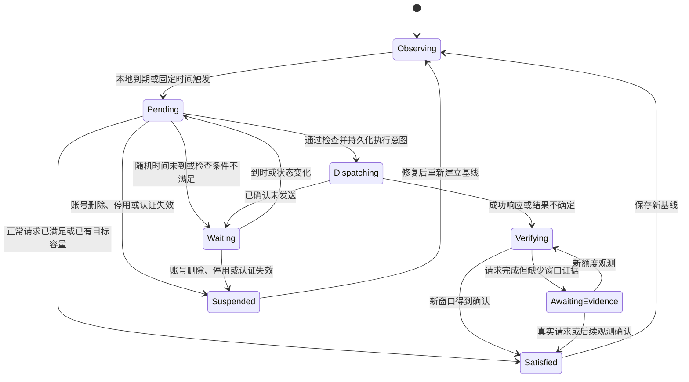

# Codex 额度窗口唤醒插件设计

适用范围：V1 Go 原生插件。V2 请查阅 [当前文档导航](../../README.md)。本页的历史设计与 V1 状态不代表当前 V2 能力。

状态：规则设计已补充官方接口核对和可编译核心骨架；完整插件、真实执行及页面尚未实现。模块边界见 [核心设计](../../development/core-architecture.md)，宿主证据见 [接口核对](cpa-integration.md)，配置契约见 [管理方案](config-management.md)。

## 1. 目标和已确定规则

插件按账号记录额度窗口，定时发送轻量请求，以尝试激活下一额度窗口。插件不能直接修改上游额度；“请求已完成”和“新窗口已确认”分别记录。

用户已确定的行为：

1. 根据本地记录的窗口到期时间触发，经过随机延迟后，用对应账号发送请求。优先读取请求携带的额度信息，信息不足时主动查询。
2. 周重置优先。按用户描述的账号行为，周重置同时重置 5 小时窗口；作为联合事件处理，并用上游状态核对。
3. 根据近期去重用户数，按配置比例决定普通 5 小时唤醒的账号数量。
4. 已处于有效 5 小时窗口内的账号不再发送唤醒请求。
5. 错过执行时间后补发；补发仍需通过当前窗口、账号、时段和名额检查。
6. 同一账号多个触发原因合并为一次请求。
7. 周任务不受近期人数和普通允许时段限制，夜间也执行。
8. 普通 5 小时任务：允许时段内按人数需求执行；夜间仅在近期仍有真实用户活动时按人数需求执行。
9. 支持每日固定时间范围，例如 09:00～09:10。

以下默认参数是设计建议，可在管理页面修改：近期统计范围 30 分钟、每个近期用户对应 1 个可用账号、重置后的随机延迟 0～10 分钟、固定时间任务最低目标 1 个账号、全局生成并发 1。

## 2. 术语

| 术语 | 含义 |
| --- | --- |
| 5 小时窗口 | 上游账号的短期额度窗口；若上游报告其他长度，使用报告值，不人为固定为 5 小时 |
| 周窗口 | 上游报告的周额度窗口；缺少该维度时不启用周规则，不把月窗口当周窗口 |
| 允许时段 | 用户配置的普通唤醒时间段，例如 08:00～23:00；不是额度窗口 |
| 本地到期 | 本地记录的重置时间已过去，需要检查和可能唤醒；不等于上游已确认重置 |
| 联合周重置 | 同一账号的周重置及其伴随的 5 小时重置 |
| 激活 | 实际生成请求使新窗口开始计时；必须单独验证，不能仅凭 HTTP 成功认定 |
| 真实用户活动 | 经过宿主认证、来自正常业务入口的用户请求；排除插件请求、额度查询和健康检查 |

“窗口期内不发送”约束的是已经确认有效的 5 小时窗口。仍处于有效周窗口且有周额度的账号，可以在 5 小时窗口结束后执行普通唤醒，否则普通规则会整个星期无法执行。

## 3. 核心不变量

- 一个账号最多只有一个未完成的合并唤醒任务，以及一个正在发送或验证的操作。
- 一个窗口周期的随机执行时间只抽取一次，重启、配置热更新和名额变化不重新抽取。
- 本地到期时间生成任务；是否需要发送由当前状态决定。
- 已确认存在有效 5 小时窗口时，不发送任何唤醒请求。周重置先核对联合重置状态，不以旧的 5 小时记录阻挡新周期，也不绕过已经确认的新窗口。
- 普通自动任务受人数名额约束；周任务独立执行。周任务开启的新窗口，若该账号参与普通账号池，则计入普通可用账号数。
- 到期任务在不能执行时保留，不因错过随机时间而删除。
- 不使用 `发送时间 + 5 小时/7 天` 替代上游报告的新重置时间。
- 超时或连接中断后的发送结果可能不确定，不直接再次发送。
- 不保存或记录原始用户 API key、账号 token 或请求正文；用户统计只保存不可逆的本地身份标识和最近活动时间。

## 4. 本地数据

### 4.1 账号记录

```text
AccountState
  account_id                  宿主稳定账号标识
  credential_generation       凭据代际，用于识别删除、替换和重新登录
  enabled / rule_overrides
  quota_snapshot
    observed_at / source
    allowed
    five_hour: reset_at, remaining, duration, evidence
    weekly:    reset_at, remaining, duration, evidence
  local_baselines
    five_hour: cycle_id, stable_reset_at, last_confirmed_activation
    weekly:    cycle_id, stable_reset_at, last_confirmed_activation
  last_real_request_at
  pending_intents[]
  merged_job
  last_operation / backoff_until
```

剩余额度按上游实际提供的百分比或额度单位保存，不把百分比转换成固定 token 数或请求次数。

### 4.2 事件意图和任务

```text
Intent
  event_id                    账号 + 凭据代际 + 规则 + 本地周期标识
  reason                      weekly_reset / five_hour_reset / daily_schedule
  original_due_at
  randomized_due_at
  created_at
  status                      pending / satisfied / superseded

MergedJob
  account_id / credential_generation
  covered_event_ids[]         发送前冻结实际覆盖的事件集合
  next_check_at
  state
  hold_reason
  reservation_id
  operation_id
  dispatch_intent_at
  send_outcome
  next_verification_at
```

周期标识使用本地持久化序号和已确认的稳定重置基线，不把每次查询变化的时间戳都当成新周期。每日定时事件使用规则 ID 和配置时区中的日期。

随机截止时间、任务、执行意图和结果均持久化。账号替换凭据后，旧任务不自动绑定新账号；先重新查询额度，建立新基线。

## 5. 额度观测与窗口判定

### 5.1 信息来源

由插件适配器统一接入三类信息。已核对的原生账号列表不直接提供完整窗口，也没有可直接调用的 `host.quota.fetch` RPC；主动查询需独立的额度适配器，具体证据见 [接口核对](cpa-integration.md)。

1. 正常业务请求或唤醒请求的额度响应头、流内额度事件。
2. 主动额度查询结果。
3. 已持久化的稳定窗口基线。

使用收到观测的时间及其操作序号防止旧查询结果覆盖较新的请求结果。缺失字段保留已有信息并标记不完整；不能把“缺失”当作额度已恢复。

请求返回信息不足时，主动查询该账号额度。正常请求的额度观测也会更新插件状态，并可能满足待唤醒任务。

### 5.2 到期前后

1. 已有稳定本地基线，且 `now < reset_at`：保持等待，不发送。
2. `now >= reset_at`：生成对应周期的待处理事件，不自行增加下一窗口。
3. 到随机执行时间时，重新查询或使用发送前足够新的可信观测。
4. 若确认正常请求已经启动新窗口：相应事件完成，无需插件发送。
5. 若确认旧窗口结束、新窗口尚未激活，且额度允许：允许进入发送检查。
6. 若额度状态未知、观测冲突或查询失败：保留任务并重试观测。

上游可能返回零用量、重置时间随查询时间移动的未激活窗口信息。不能把每个 `now + 窗口长度` 都当成已经开始的新窗口，否则会不断推迟本地任务。也不能仅因时间戳变化就反复创建任务。

首次启用且没有历史基线时，先查询并建立观察基线，不立即补发历史任务。若无法区分有效窗口和未激活占位信息，先观察或等待本地基线到期；允许手动建立观察基线，但手动操作也不能绕过已确认的有效窗口。

### 5.3 周重置的联合处理

用户提供的行为假设是：周重置同时重置 5 小时额度。处理方式：

1. 本地周基线到期，创建高优先级周事件。
2. 为该账号的周事件抽取一次随机延迟。
3. 执行时首先查询联合窗口状态。
4. 若确认联合重置已发生：旧周周期及旧 5 小时周期的阻挡条件失效；将相关旧 5 小时任务合并或标记被新周期取代。
5. 若没有正常请求激活新窗口：一次唤醒同时尝试激活两个窗口。
6. 若正常请求已经激活新窗口：直接完成已获验证的相关事件。
7. 若实际观测与该假设不一致，仍有已确认有效的 5 小时窗口：记录 `weekly_reset_conflict`，保留周任务，等待真实窗口状态变化，不违反窗口期内不发送的约束。

周优先表示检查和执行优先、绕过人数及普通时段限制；不表示使用过期额度信息直接生成请求。

## 6. 根据人数计算普通账号名额

### 6.1 用户数

在范围为 `activity_lookback` 的滑动时间段内统计经过认证的去重用户数 `U`。

主方案使用已核对宿主请求元数据中的 `caller_scope`，它由已认证身份派生，按该值去重；若管理者建立了可靠的用户映射，则先归一化为该用户。旧版本缺少该字段时，可由完成用量事件的已认证 key 创建本地不可逆标识，并明确降级为完成请求统计。共享同一个 key 的多人在没有映射时只能统计成一个身份；一个人使用多个 key 也需要映射才能合并。不能直接相信客户端自行填写的用户 ID。

长请求执行期间该用户持续计为活跃；请求结束或业务活动更新后，其身份在统计时间段内保留。正常认证通过的业务请求可以产生需求信号；失败重试不会重复增加人数。插件生成和管理查询始终不计入。

### 6.2 名额公式

建议将“比例”明确为 `accounts_per_user`，即每个近期用户需要多少个可用账号：

```text
N = 参与普通规则且身份有效的账号数
T = min(N, max_accounts, ceil(U × accounts_per_user))
F = 当前尚未满足的固定时间事件要求的最低目标账号数，默认 1
T_effective = min(N, max_accounts, max(T, F))
A = 已有有效 5 小时窗口、且额度可用的参与账号数
P = 已预约/发送/验证、预计补充可用容量的不同账号数
K = max(0, T_effective - A - P)
```

这里的 `A` 与 `P` 是不重叠的账号集合，同一个账号不重复计数。`P` 包括已准入且不在 `A` 中的周任务，避免周任务执行的同时又安排同等数量的普通任务。

例：近期有 4 个用户、比例 0.5，目标为 2 个可用账号；已有 1 个有效窗口账号，且没有其他预约，则只需普通唤醒 1 个账号。

`U = 0` 时不新增人数驱动的普通任务，但周任务仍可执行。固定时间任务通过独立的最低目标 `F` 支持早上还没有用户时预先准备账号；该参数可设为 0。

目标降低时，只撤销尚未发送的普通预约，保留其到期意图等待后续需求；已经开始的请求继续完成验证。目标增加时，从未完成且可执行的账号中补足差额。

### 6.3 普通候选账号排序

只有窗口已结束、额度可用、无正在执行请求的账号能入选。默认排序：

1. 最近有正常用户使用的账号，帮助保留已有使用关系。
2. 到期事件等待时间更长的账号。
3. 相同条件下按持久化轮转顺序选择，避免总是选第一个账号。

同一账号有周任务时走周队列，不另占普通队列中的重复名额。周队列按原始到期时间排序；失败等待的周任务不阻塞其他账号。

此插件控制唤醒，不接管宿主正常账号路由。若宿主继续把业务流量轮询到所有未激活账号，用户真实请求仍可能开启更多窗口；人数目标只约束插件主动准备的容量，不能保证整个账号池始终只有 `T` 个有效窗口。

## 7. 时段、固定时间及补发

### 7.1 普通时段

- 在允许时段内：人数任务按 `K` 执行；固定时间任务按其最低目标执行。
- 在允许时段外：只有 `U > 0` 时执行人数驱动的普通任务，仍使用人数比例，不唤醒全部账号。
- 固定时间任务默认只在允许时段内补发，不自行创建夜间例外；若配置的固定时间范围完全落在禁止时段，保存配置时提示该任务会等待允许时段。
- 周任务在所有时段可执行，不受 `U` 限制。

时段支持跨午夜，例如 22:00～02:00。内部时间使用 UTC，日历与每日规则使用配置的 IANA 时区。

### 7.2 随机时间

```text
重置事件：randomized_due_at = stable_reset_at + uniform(min_delay, max_delay)
每日定时：randomized_due_at = 当天配置时间范围内随机时间
```

发送最早时间等于抽中的时间，而不是重新查询的时间。实际发出时间还可能受窗口、人数、并发和故障影响。随机分散不保证账号间没有碰撞，全局队列控制实际并发。

### 7.3 补发

若插件晚启动、进程停机、网络失败、没有名额或时段不允许，保留到期任务。障碍解除后无需重新等待完整的 0～10 分钟，进入全局队列即可；队列间隔仍会错开发送。

补发执行前使用当前状态。期间已由真实请求完成的事件不再补发；旧周期被确认的新周期替代时，旧事件被取代。多个停机期间的历史事件不能产生多次补发。

每日定时规则恢复时，只保留最近一次应该发生而未满足的事件，不回放每天一个请求。上一日未完成事件被下一日同一规则替代；本日事件已满足则当天不再次执行。

固定时间目标是账号池的容量目标，不是每个账号都收到一次 ping。只选择不足名额所需的到期账号。若所有账号仍在有效窗口内，已有容量满足目标则完成该事件；若容量不足，保留事件，等符合条件的账号出现后补发。

## 8. 合并与执行顺序

合并范围为同一稳定账号、同一凭据代际。不同账号不合并。

每日任务先按池目标选账号；选定后它与该账号的到期意图合并。未选定的每日池任务不强行给每个账号生成任务。

1. 以最高优先级的已到执行时间事件决定队列等级：周 > 每日固定时间 > 普通 5 小时。
2. 只要至少一个事件通过时段和名额检查，账号可以进入发送前检查；周事件单独通过时，不需为附带的普通事件申请第二个名额。
3. 合并已经到期且可由当前一次请求满足的事件；不会为了合并去提前执行尚未到时的每日事件。
4. 发送前冻结 `covered_event_ids`；执行中新增事件留待下一轮判断，不能错误地被这次较早请求标记完成。
5. 合并不意味着所有结果都成功。分别验证 5 小时窗口、周窗口，以及每日目标容量。

发送前完整检查顺序：

```text
账号和凭据仍匹配
  → 对该账号取得执行锁
  → 至少一个触发已到随机执行时间
  → 最新额度状态可信且允许生成
  → 周事件先处理联合重置状态
  → 没有已确认有效的 5 小时窗口
  → 没有正常请求正在占用该账号，未被正常请求满足
  → 时段与人数名额检查（周事件豁免）
  → 获得全局生成并发槽及账号容量预约
  → 持久化执行意图，发送指定账号的轻量请求
```

生成通过宿主提供的精确账号执行能力完成，不能用普通 `/v1` 路由猜测目标账号。宿主适配器应优先复用宿主的凭据刷新、账号代理及额度查询能力；开发前核对实际 CPA 版本提供的接口。

## 9. 状态机



`hold_reason` 使用具体原因：`not_due`、`active_five_hour`、`quota_unknown`、`quota_exhausted`、`outside_hours`、`no_demand`、`target_satisfied`、`foreground_busy`、`backoff`、`credential_changed`、`weekly_reset_conflict`。

## 10. 请求完成、验证和失败

### 10.1 完成与验证

- 消费完整响应流，识别正常完成、流内限流和错误。HTTP 200 本身不足以说明生成已完成。
- 优先使用返回额度信息；字段不足则主动查询。验证查询建议等待 5 秒、30 秒、2 分钟，具体可配置。
- 新窗口证据需要关联本次操作或真实请求，以及可信的额度状态；仅用量为零或任意时间戳变化不足以认定成功。
- 先更新确认的新基线，再标记被覆盖事件完成，并清理本地预约。
- 5 小时和周分别确认。例如短期已确认、周信息暂缺：不再次生成，仅保留周验证。

### 10.2 不确定结果

发送超时、响应截断、崩溃恢复发现未完成发送意图时，进入验证状态。网络请求和本地提交无法做到绝对原子，因此不承诺在任意故障下恰好执行一次。

此时持续查询额度，默认抑制同一账号再次唤醒。只有可信信息证明没有激活且之前没有完成生成，才允许受限重试；无法证明时保留 `AwaitingEvidence`，允许正常业务请求提供新证据。管理页面可手动处理，但不能绕过当前有效窗口。

### 10.3 明确失败

- 确认请求尚未送出：退避重试，保留原随机时间。
- 明确限流：按上游重置时间或 Retry-After 等待，不把账号算作可用容量；若送达或窗口状态不确定，先验证，限流退避本身不解除重复发送抑制。只有确认未发送才能重新排队生成。
- 认证失效或账号停用：暂停，恢复后重新建立基线。
- 模型不支持或请求格式错误：暂停生成并显示可修复原因，不不断切换模型重试。
- 查询失败：保留最近基线，标记观测过期，重试查询而不生成。

已发送但未确认的账号暂占一个普通容量预约，防止同一轮无限补充账号。`verification_capacity_hold` 默认 15 分钟，从发送完成或结果转为不确定时起计，持久化 `CapacityHoldUntil`。到时或确认账号不可用后可释放容量预约，同时保留该账号的重复发送抑制；重新查询、热更新和重启不延长已经抽定的保留期限。

## 11. 调度算法

```text
启动：
  读取持久化状态，恢复账号、随机时间和执行意图
  与宿主账号列表核对凭据代际
  对未完成发送只做验证
  首次账号查询并建立观察基线

收到正常请求/额度观测/时钟事件：
  更新用户活动、额度和稳定窗口证据
  生成或满足本地到期事件、每日池目标事件
  周事件处理联合重置，并吸收对应旧 5 小时事件
  对已正常激活的账号取消多余待发送任务
  计算 U、普通目标 T_effective、已有容量 A、预约 P
  撤销超过目标的未发送普通预约
  先选可执行周任务，再以差额 K 选择普通候选
  保留没有名额、被时段阻挡或尚在窗口内的任务
  为选中账号合并到期事件，安排最近一次检查

执行账号任务：
  取得锁，读取足够新的额度观测，重新执行所有准入检查
  如果已有新窗口：根据证据满足事件，不发送
  如果条件不满足：记录 hold_reason 和 next_check_at
  否则预约容量、持久化执行意图、精确绑定账号发送
  读取响应并查询缺失额度
  分窗口验证结果、更新基线和任务，再触发容量重算
```

定时器按最早到期任务安排唤醒，并配一个低频巡检用于发现丢失的通知、用户统计过期和外部账号变化。不用“每 5 小时发一次”的固定轮询替代实际窗口。

用户统计过期也是调度事件；没有新请求时，人数仍应随时间下降。全局并发和预约在一处统一仲裁，两个任务不能同时读取相同的容量差额并各自填满。

第一版限定每个账号池只有一个插件执行实例。若支持多个 CPA 实例共享账号，必须增加共享执行租约和统一人数来源；本地锁和本地文件无法防止跨主机重复请求。

## 12. 建议配置

以下是待实现插件的配置草案，不是现有 CPA 插件可直接使用的配置。

```yaml
timezone: Asia/Shanghai

reset_rules:
  five_hour:
    enabled: true
    random_delay: {min: 0s, max: 10m}
  weekly:
    enabled: true
    random_delay: {min: 0s, max: 10m}
    bypass_activity_limit: true
    bypass_allowed_hours: true

activity:
  lookback: 30m
  accounts_per_user: 1.0
  max_accounts: 10
  identity_source: host_caller_scope

ordinary_rules:
  allowed_hours: ["08:00-23:00"]
  allow_outside_hours_when_users_active: true

daily_rules:
  - id: morning
    enabled: true
    random_time_range: "09:00-09:10"
    minimum_ready_accounts: 1
    catch_up: true

execution:
  model: "部署时选择账号支持的模型"
  prompt: "Reply OK."
  max_concurrency: 1
  min_dispatch_spacing: 5s
  quota_max_age_before_send: 30s
  verify_delays: [5s, 30s, 2m]
  verification_capacity_hold: 15m
  catch_up: true
```

账号页面支持加入或退出普通规则、周规则、单独随机延迟、独立允许时段和手动暂停。池级用户统计和普通总名额统一计算；账号覆盖不能使总名额被重复计算。

更改配置立即重算准入条件。已经创建事件的随机时间默认保留；若用户主动要求重新安排则生成新的任务版本，并保留审计记录。

## 13. 管理页面

账号表显示：当前 5 小时/周额度、各自重置时间、观测来源与时间、下一随机检查时间、合并触发原因、等待原因、上次请求结果、窗口验证结果。

池级显示：近期去重用户数 `U`、比例、目标账号数、已有可用数 `A`、预约数 `P`、普通待补数 `K`、周任务数，以及身份统计采用的口径。

典型日志：

```text
账号 A：周重置到期，随机安排 02:07；豁免夜间与人数限制。
账号 A：周与旧 5 小时事件合并，请求已完成；短期窗口已确认，周窗口等待查询。
账号 B：5 小时到期，因夜间近期用户数为 0 暂缓，保留补发。
账号 C：执行前观察到用户正常请求已激活新窗口，取消唤醒。
池：近期用户 4，比例 0.5，目标 2；已有 1、预约 1，无需额外唤醒。
```

## 14. 设计验收场景

| 场景 | 预期 |
| --- | --- |
| 本地 5 小时仍有效 | 不生成唤醒请求 |
| 5 小时到期、抽中第 8 分钟，第 3 分钟用户正常请求激活 | 取消待发送任务，更新真实基线 |
| 夜间普通到期且 U=0 | 保留任务，不发送；有需求或允许时段到来后重算 |
| 夜间普通到期且 U=3、比例 0.5、A=1、P=0 | 目标 2，仅补 1 个普通账号 |
| 夜间周到期且 U=0 | 查询联合状态，随机时间到后尝试一次唤醒 |
| 周重置同步重置短期窗口 | 合并旧短期事件，一次请求，分别验证两个窗口 |
| 周重置观测与短期有效窗口冲突 | 不发送，显示冲突，继续观测 |
| 周和固定时间和短期事件同时到时 | 同账号一次请求；不同账号保持独立 |
| A 与 P 已满足人数目标 | 不额外发送普通请求 |
| U 降低 | 释放未发送普通预约，保留到期意图，不终止正在验证的请求 |
| 09:00 定时、U=0、最低目标 1、全部短期已到期 | 随机时间到后唤醒一个符合条件的账号 |
| 09:00 定时、已有 1 个可用窗口、最低目标 1 | 当天目标已满足，不发送 |
| 插件停机错过时间 | 恢复后重查并补发最新有效事件，不回放历史请求 |
| 到期后观测到移动的零用量占位重置时间 | 不覆盖稳定到期基线，不无限延后，不重复创建周期 |
| 请求超时后重启 | 恢复验证，默认不重发 |
| 返回额度只有短期字段 | 更新短期，主动查询周状态，不额外生成 |
| 账号删除或凭据替换 | 取消旧绑定，不把旧任务发到新账号 |
| 宿主正常路由将流量分散到更多账号 | 如实更新容量，不声称插件控制了宿主路由 |

## 15. 参考实现与待核对接口

- [codex-keepalive](https://github.com/elunez/codex-keepalive)：每日定时、账号列表、账号代理和轻量生成请求的现有插件参考。
- [额度窗口解析](https://github.com/JefferyZhang2019/cpa-plugin-codex-quota-scheduler/blob/main/quota.go)：周/短期窗口、剩余比例和重置时间的社区解析实现。
- [重置探测](https://github.com/JefferyZhang2019/cpa-plugin-codex-quota-scheduler/blob/main/probe.go) 与 [窗口分类](https://github.com/JefferyZhang2019/cpa-plugin-codex-quota-scheduler/blob/main/probe_classify.go)：本地基线、未激活窗口和请求后验证的参考。
- [OpenAI 官方额度说明](https://learn.chatgpt.com/docs/pricing)：实际限制和重置时间应以账号当前状态为准。

当前官方接口的核对结果见 [适配文档](cpa-integration.md)。开发及部署仍需确认具体 CPA 版本支持精确账号执行、正常请求生命周期、认证 `caller_scope` 和所采用的额度查询路径。若不能观测独立自然人，只能提供认证身份去重统计并明确显示口径；如果连认证身份也不能得到，就需要额外的业务入口观测接口，不能伪造用户数。

本设计不使用付费额度重置 credits，也不实现主动购买额度。周与 5 小时重置关系采用用户说明，并保留实际观测不一致时的等待逻辑。
